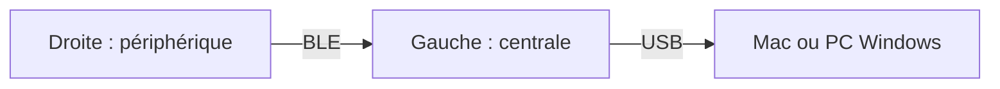
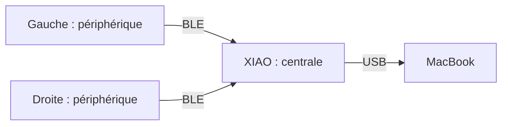
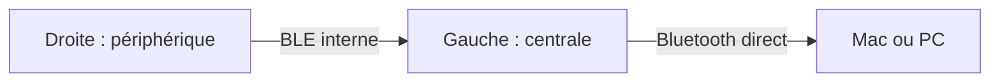

# Matériel et connexions

## Les équipements

| Nom | Usage |
| --- | --- |
| PC Windows | Fixe assemblé à domicile, utilisé pour jouer et regarder des vidéos/séries |
| MacBook Pro M4 Max | Travail et développement, au bureau comme en télétravail |
| Clavier V1 | À domicile, sans batterie, profil `wire`, habituellement sur le PC Windows |
| Clavier V2 | Au travail, une batterie par moitié, Bluetooth direct vers le Mac |

V1 fonctionne aussi en `wire` sur le Mac en télétravail. Les noms V1/V2 désignent
le matériel, indépendamment de l’ordinateur connecté. Le XIAO BLE de V2 reste
disponible pour le profil dongle historique.

## Le matériel

| Élément | Fonction |
| --- | --- |
| Deux répliques de nice!nano v2 | Une par moitié : touches, encodeur, USB et BLE |
| 42 touches et deux encodeurs cliquables | 21 touches et un encodeur par moitié, soit 44 positions |
| Deux PCB et deux boîtiers | Câblage et support mécanique |
| XIAO BLE | Centrale USB de V2 en mode dongle |
| Batteries de V2 | Alimentation des moitiés sans câble permanent |

Le Nordic des anciennes photos n’est pas utilisé. Les fichiers de
[PCB](<../Design PCB/>) et de [boîtier](<../Design 3D/>) sont dans le dépôt.
Aucune LED externe n’est installée, seules celles des microcontrôleurs sont présentes.
La migration n’active pas d’indicateur LED supplémentaire.

Sur V2, distinguer l’interrupteur de batterie et l’alimentation USB.
Une moitié branchée en USB est alimentée même avec l’interrupteur sur arrêt.
Pour la mettre réellement hors tension, débrancher l’USB et couper la batterie.
Un câble USB ne signifie pas que les touches passent par USB : cela dépend du profil.

## Centrale et périphériques

La **centrale** rassemble les événements, applique la keymap et envoie les touches
à l’ordinateur. Un **périphérique** lui transmet ses événements, il n’est pas un
clavier USB autonome. Cet état partagé permet à Shift sur une moitié de modifier
une lettre sur l’autre. [Rôles ZMK](https://zmk.dev/docs/features/split-keyboards).

Les schémas montrent le trajet des touches. L’alimentation est décrite à part.

## Profil `wire`, USB vers l’ordinateur

Les deux câbles USB alimentent les moitiés. Le câble gauche transporte aussi la saisie,
le câble droit fournit l’alimentation. Les moitiés communiquent toujours en BLE,
les deux câbles ne les relient pas entre elles.

Veille profonde et reporting batterie sont désactivés. Les capacités BLE vers
un hôte restent présentes, ce profil ne promet pas une radio arrêtée.

**État :** flash et fonctionnement de V1 confirmés sur le Mac avec `wire macos`.
Le profil `wire windows` (gaming inclus) est aussi flashé et fonctionnel sur V1.
La variante de diagnostic fonctionne aussi sur le Mac. Le parcours complet des touches et couches reste
à faire, voir [les essais wire](tests-wire.md).

## Dongle, configuration historique

Les moitiés sont sur batterie, le Mac alimente le XIAO. Le dongle traite les
couches et les événements des deux moitiés.
[Architecture ZMK](https://zmk.dev/docs/hardware-integration/dongle).

**État :** utilisé auparavant avec la branche historique `dongle`, pas encore réintégré au
build paramétrable. Le build local produit les profils `wire` et `bluetooth`.

## Profil `bluetooth`, sans dongle

Les moitiés fonctionnent sur batterie. La gauche remplace le dongle comme centrale
et communique avec l’ordinateur. Son autonomie sera à mesurer avec ce nouveau rôle.
La sortie clavier USB est désactivée : brancher un câble pour charger conserve
la saisie en Bluetooth, même si le câble va à l’ordinateur.

La veille profonde est activée après 15 minutes sur batterie, avec la matrice comme
source de réveil. Les mesures de batterie sont activées.

**État :** deux UF2 normaux flashés, saisie des deux moitiés sur le Mac confirmée
avec alimentation USB et sur batterie seule, sans dongle. Le profil d’essai confirme
un réveil sans reset sur chaque moitié. Le premier appui sert au réveil, et la
gauche doit être éveillée pour recevoir la droite. Toutes les touches et les
encodeurs restent à vérifier, voir [veille et réveil](veille.md).
Voir [la procédure de reset](appairage-bluetooth.md#réinitialiser-les-réglages)
en cas d’appairage incohérent.
La priorité USB est différée après l’auto-détection d’OS, pour viser un clavier
qui adapte automatiquement sa keymap et sa sortie USB/Bluetooth.

## Affichage des batteries

Les deux niveaux sont lus sur le Mac via la gauche : 63 % à gauche et 62 % à droite
lors de l’essai. Le menu Bluetooth macOS ne présente que la gauche.
Un lecteur dédié sera nécessaire pour présenter les deux ensemble.
Voir [la configuration et les essais](batteries.md).

## Ce qui change par firmware ou à chaud

| Changement | Mécanisme |
| --- | --- |
| Profil `wire` ou `bluetooth` | Choix au build, puis flash des deux moitiés. Les rôles restent identiques |
| Sortie USB ou Bluetooth à chaud | ZMK propose `&out` si les deux sorties sont compilées. Ces touches restent à ajouter |
| Gauche centrale ou dongle central | Firmwares adaptés et procédure d’appairage, pas un toggle de sortie |

Le choix de sortie à chaud est sauvegardé et peut survivre aux flashs. Pour le futur
profil avec priorité USB, on vise USB avec un câble de données vers le Mac, puis
Bluetooth après débranchement. La charge secteur et le recours à une sélection BLE manuelle
restent à tester. [Sorties ZMK](https://zmk.dev/docs/keymaps/behaviors/outputs).

## Les fichiers de configuration

La **board** décrit le contrôleur, le **shield** décrit le clavier monté dessus.
Le build migré cible `nice_nano@2.0.0//zmk`, avec les shields
`splitergoll_left` ou `splitergoll_right`. L’archive ZMK 0.3.0 garde l’ancien
nom `nice_nano_v2`. Les essais matériels cités ici précèdent la migration.

| Fichier | Rôle |
| --- | --- |
| [config/splitergoll.conf](../config/splitergoll.conf) | Options communes : split, BLE, encodeurs et macros |
| [left.conf](../boards/shields/splitergoll/splitergoll_left.conf) / [right.conf](../boards/shields/splitergoll/splitergoll_right.conf) | Gauche centrale avec USB par défaut, droite périphérique |
| [wire.conf](../config/profiles/wire.conf) / [bluetooth.conf](../config/profiles/bluetooth.conf) | Sortie et alimentation propres à chaque profil |
| [splitergoll.dtsi](../boards/shields/splitergoll/splitergoll.dtsi) | Matrice, ordre des 44 positions et encodeurs |
| [Overlay gauche](../boards/shields/splitergoll/splitergoll_left.overlay) / [droite](../boards/shields/splitergoll/splitergoll_right.overlay) | GPIO de chaque moitié et encodeur actif |
| [build.yaml](../build.yaml) | Deux profils matériels, quatre keymaps et deux moitiés pour le workflow GitHub manuel |

Chaque moitié scanne quatre lignes et six colonnes. Le transform associe les
positions câblées à la keymap. Les rotations des encodeurs sont distinctes de leurs clics.
La matrice est déclarée comme source de réveil. Le profil câble garde la veille
profonde désactivée. Voir [veille et réveil](veille.md).

Pour les affectations : [keymap](keymap.md). Pour compiler : [build local](build-local.md).
Les essais restent dans le [TODO](TODO.md). Le build ne flashe aucun appareil.
