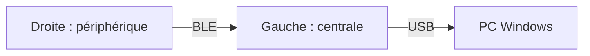
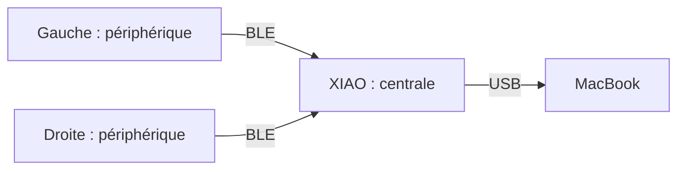

# Matériel et connexions

Deux claviers existent : PC Windows avec deux câbles USB, MacBook avec batteries
et dongle. La différence principale est la carte qui traite les touches.

## Le matériel

| Élément | Fonction |
| --- | --- |
| Deux répliques de nice!nano v2 | Une par moitié : touches, encodeur, USB et BLE |
| 42 touches et deux encodeurs cliquables | 21 touches et un encodeur par moitié, soit 44 positions |
| Deux PCB et deux boîtiers | Câblage et support mécanique |
| XIAO BLE | Centrale USB du clavier Mac en mode dongle |
| Batteries du clavier Mac | Alimentation des moitiés sans câble permanent |

Le Nordic des anciennes photos n’est pas utilisé. Les fichiers de
[PCB](<../Design PCB/>) et de [boîtier](<../Design 3D/>) sont dans le dépôt.

## Centrale et périphériques

La **centrale** rassemble les événements, applique la keymap et envoie les touches
à l’ordinateur. Un **périphérique** lui transmet ses événements, il n’est pas un
clavier USB autonome. Cet état partagé permet à Shift sur une moitié de modifier
une lettre sur l’autre. [Rôles ZMK](https://zmk.dev/docs/features/split-keyboards).

Les schémas montrent le trajet des touches. L’alimentation est décrite à part.

## Profil `wire`, USB vers l’ordinateur

Les deux câbles USB alimentent les moitiés. Le câble gauche transporte aussi la saisie,
le câble droit fournit l’alimentation. Les moitiés communiquent toujours en BLE,
les deux câbles ne les relient pas entre elles.

Veille profonde et reporting batterie sont désactivés. Les capacités BLE vers
un hôte restent présentes, ce profil ne promet pas une radio arrêtée.

**État :** deux UF2 compilés et rôles vérifiés, essai matériel à faire.
Ce profil sert au premier essai sur le clavier Mac et au clavier du PC Windows.

## Dongle, MacBook actuel

Les moitiés sont sur batterie, le Mac alimente le XIAO. Le dongle traite les
couches et les événements des deux moitiés.
[Architecture ZMK](https://zmk.dev/docs/hardware-integration/dongle).

**État :** utilisé avec la branche historique `dongle`, pas encore réintégré au
build paramétrable. `make build` produit uniquement le profil câble.

## Bluetooth direct, futur profil Mac

Les moitiés restent sur batterie. La gauche remplace le dongle comme centrale
et communique avec le Mac. Son autonomie sera à mesurer avec ce nouveau rôle.

**État :** à implémenter et tester. La priorité USB pendant la charge sera une
option de cette architecture, avec la même centrale.

## Ce qui change par firmware ou à chaud

| Changement | Mécanisme |
| --- | --- |
| Sortie USB ou Bluetooth de la même centrale | ZMK propose `&out`, ces touches restent à ajouter dans la keymap |
| Gauche centrale ou dongle central | Firmwares adaptés et procédure d’appairage, pas un toggle de sortie |

Le choix de sortie est sauvegardé et peut survivre aux flashs. Pour le futur profil
direct, on vise USB avec un câble de données vers le Mac, puis Bluetooth après
débranchement. La charge secteur et le recours à une sélection BLE manuelle
restent à tester. [Sorties ZMK](https://zmk.dev/docs/keymaps/behaviors/outputs).

## Les fichiers de configuration

La **board** décrit le contrôleur, le **shield** décrit le clavier monté dessus.
ZMK 0.3.0 cible `nice_nano_v2` avec `splitergoll_left` ou `splitergoll_right`.

| Fichier | Rôle |
| --- | --- |
| [config/splitergoll.conf](../config/splitergoll.conf) | Options communes : split, BLE, encodeurs et alimentation |
| [left.conf](../boards/shields/splitergoll/splitergoll_left.conf) / [right.conf](../boards/shields/splitergoll/splitergoll_right.conf) | Gauche centrale USB, droite périphérique |
| [splitergoll.dtsi](../boards/shields/splitergoll/splitergoll.dtsi) | Matrice, ordre des 44 positions et encodeurs |
| [Overlay gauche](../boards/shields/splitergoll/splitergoll_left.overlay) / [droite](../boards/shields/splitergoll/splitergoll_right.overlay) | GPIO de chaque moitié et encodeur actif |
| [build.yaml](../build.yaml) | Couples board/shield et noms des deux UF2 |

Chaque moitié scanne quatre lignes et six colonnes. Le transform associe les
positions câblées à la keymap. Les rotations des encodeurs sont distinctes de leurs clics.
La matrice est déclarée comme source de réveil. Le profil câble garde la veille
profonde désactivée. Voir [veille et redémarrage](veille-et-demarrage.md).

Pour les affectations : [keymap](keymap.md). Pour compiler : [build local](build-local.md).
Les essais restent dans le [TODO](TODO.md). Le build ne flashe aucun appareil.
